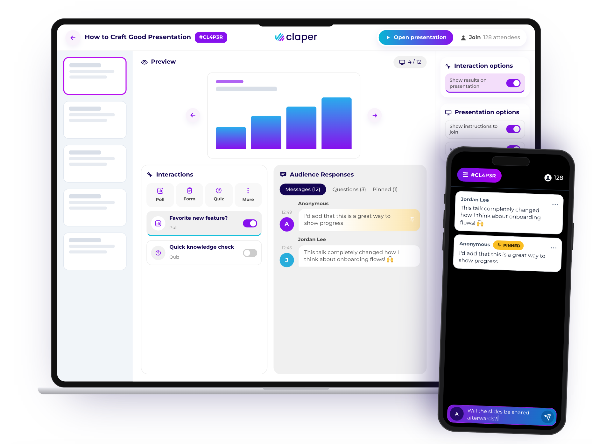

<div align="center">

<a href="https://claper.co">
  <picture>
    <source media="(prefers-color-scheme: dark)" srcset="priv/static/images/logo-large.svg" />
    <source media="(prefers-color-scheme: light)" srcset="priv/static/images/logo-large-black.svg" />
    
  </picture>
</a>

### Turn slides into a live conversation.

The open-source, self-hostable alternative to Mentimeter, Slido and Wooclap.<br />
Add **Q&A**, **polls**, **quizzes**, **forms**, **live captions** and **reactions** to the slides you already have.<br />
Your audience joins from their phone: no app, no account.

<p>
  <a href="https://app.claper.co/users/log_in"><strong>Try it free</strong></a> ·
  <a href="https://docs.claper.co/self-hosting/quick-start.html"><strong>Self-host</strong></a> ·
  <a href="https://docs.claper.co"><strong>Documentation</strong></a> ·
  <a href="https://claper.co"><strong>Website</strong></a> ·
  <a href="https://discord.gg/M7ejVaC9gA"><strong>Discord</strong></a>
</p>

<p>
  <a href="https://github.com/ClaperCo/Claper/releases/latest"></a>
  <a href="https://github.com/ClaperCo/Claper/actions/workflows/elixir.yml"></a>
  <a href="https://github.com/ClaperCo/Claper/pkgs/container/claper"></a>
  <a href="LICENSE.txt"></a>
  <a href="https://github.com/ClaperCo/Claper/stargazers"></a>
  <a href="https://discord.gg/M7ejVaC9gA"></a>
</p>

</div>

<p align="center">
  <a href="https://claper.co">
    
  </a>
</p>

<p align="center">
  <sub>Used by <b>7,000+ speakers</b> at teams and institutions like CERN, Red Hat, KU Leuven, TU München and Deutsche Telekom (<a href="https://claper.co">claper.co</a>).</sub>
</p>

---

## ⚡ Get started

Pick the option that fits. The code is the same in both.

| | ☁️ **Claper Cloud** | 🏠 **Self-hosted** |
|---|---|---|
| **Setup** | None, sign up and present | One `docker compose up` |
| **Price** | Free up to 10 attendees, then [pay per event](https://claper.co/#pricing) | Free, no attendee limit |
| **Data** | Hosted in the EU 🇪🇺 | Stays on your servers |
| **Updates** | Handled by the Claper team | You decide when |
| | [**Try Claper for free →**](https://app.claper.co/users/log_in) | [**Run it yourself ↓**](#-self-host-in-2-minutes) |

## 🎯 How it works

1. **Upload your deck.** PDF, PPT or PPTX. No new slide editor to learn.
2. **Add interactions.** Polls, quizzes, forms, web content and live captions, attached to any slide.
3. **Share the code.** Attendees scan the QR code or type the event code on their phone.
4. **Present.** Responses, questions and reactions appear live on your slides and in your presenter view.
5. **Follow up.** Export messages, results and transcripts as CSV.

## ✨ Features

<table>
<tr>
<td width="50%" valign="top">

#### 💬 Q&A and messages
- Attendees post questions and comments, named or anonymous
- Sort questions by popularity, pin the best ones, reply in-thread
- Show messages on the big screen or keep them private
- Moderation: delete messages, ban attendees, show pinned only

#### 📊 Polls, quizzes and forms
- Live polls with results revealed on your slides
- Scored quizzes with correct answers and per-attendee results
- Feedback forms to collect structured answers
- Reactions (👏 ❤️ 💯 🙌) on the slide, in real time

#### 🎙️ Live captions
- Real-time transcription displayed to the audience
- Searchable transcript kept and exportable after the talk
- Powered by Mistral, using your own API key

</td>
<td width="50%" valign="top">

#### 🖥️ Presenting
- Separate presenter and manager views, synced in real time
- Embed YouTube, Vimeo, Canva, Google Slides or any web page
- Keyboard navigation, drag-and-drop ordering
- Co-host with facilitators

#### 🎓 Education and LMS
- LTI 1.3 integration with Moodle and other compatible LMS
- Quiz scores sent back to the LMS gradebook
- Export quizzes in QTI format
- Quiz CSV totals require all correct options and no incorrect options, matching application scoring

#### 🔐 Built for organizations
- SSO with any OpenID Connect provider, or SSO-only by disabling password login
- Admin panel: users, roles, events, OIDC providers, audit log
- Local or S3-compatible storage, SMTP or Postmark email
- Official Docker image
- 10 languages: 🇬🇧 🇫🇷 🇩🇪 🇪🇸 🇳🇱 🇮🇹 🇭🇺 🇱🇻 🇸🇪 🇯🇵

</td>
</tr>
</table>

## 🤔 Why Claper

- **Own your data.** Audience questions and votes can be sensitive. Self-host Claper and keep them on your infrastructure.
- **Keep your slides.** Present your existing PDF or PowerPoint deck instead of rebuilding it in another tool.
- **No per-seat subscription.** Self-hosting is free, and cloud plans are priced per event.
- **Open source, for real.** AGPL-3.0, developed in the open since 2022, with a public changelog.
- **Real-time by design.** Built on Elixir and Phoenix LiveView, a stack made for many concurrent live connections.

Comparing tools? Read Claper vs [Slido](https://claper.co/blog/claper-vs-slido), [Mentimeter](https://claper.co/blog/claper-vs-mentimeter), [Wooclap](https://claper.co/blog/claper-vs-wooclap) and [AhaSlides](https://claper.co/blog/claper-vs-ahaslides).

## 🏠 Self-host in 2 minutes

Requirements: Docker with Compose.

```bash
git clone https://github.com/ClaperCo/Claper.git && cd Claper
cp .env.sample .env

# Generate a unique secret. Keep it: Claper uses it to encrypt stored settings.
sed -i.bak "s|^SECRET_KEY_BASE=.*|SECRET_KEY_BASE=$(openssl rand -base64 48)|" .env

docker compose up -d
```

Open <http://localhost:4000> and sign in with the default admin account:

| Email | Password |
|---|---|
| `admin@claper.co` | `claper` |

> [!IMPORTANT]
> Change the default password right after your first login. To serve Claper on a public domain, set `BASE_URL` in `.env` and put it behind HTTPS ([Traefik example](https://docs.claper.co/self-hosting/quick-start.html#ssl-with-traefik)).

**Next steps**

- [Configuration reference](https://docs.claper.co/self-hosting/configuration.html): storage, email, sign-up, legal links, reverse proxy
- [Single sign-on (OIDC)](https://docs.claper.co/integration/oidc.html)
- [LMS integration (LTI 1.3)](https://docs.claper.co/integration/lti.html)
- [Updating Claper](https://docs.claper.co/self-hosting/updating.html)

## 🧱 Built with

[![Elixir][Elixir]][Elixir-url] [![Phoenix][Phoenix]][Phoenix-url] [![PostgreSQL][PostgreSQL]][PostgreSQL-url] [![Tailwind][Tailwind]][Tailwind-url]

Phoenix LiveView for real-time UI, PostgreSQL for storage, Oban for background jobs.

## 🤝 Contributing

Contributions of all sizes are welcome: bug reports, features, docs and translations.

1. Fork the repository and create a branch from `dev`
2. Set up your environment with the [development guide](https://docs.claper.co/self-hosting/development.html)
3. Open a pull request against `dev`

Read [CONTRIBUTING.md](CONTRIBUTING.md) for details, including how to add a new language. Not sure where to start? Browse [open issues](https://github.com/ClaperCo/Claper/issues) or ask on [Discord](https://discord.gg/M7ejVaC9gA).

<a href="https://github.com/ClaperCo/Claper/graphs/contributors">
  
</a>

## 💬 Community and support

- 💬 [Discord](https://discord.gg/M7ejVaC9gA): questions, ideas and help from the community
- 🐛 [GitHub Issues](https://github.com/ClaperCo/Claper/issues): bug reports and feature requests
- 📖 [Documentation](https://docs.claper.co): usage and self-hosting guides
- 🟠 [r/claper](https://reddit.com/r/claper) · 𝕏 [@alxlion_](https://x.com/alxlion_) (founder)
- 🔒 Security issue? Do not open a public issue, follow the [security policy](https://claper.co/security)

If Claper helps you, a ⭐ helps others find it. You can also [sponsor the project](https://github.com/sponsors/ClaperCo).

## 📄 License

Claper is licensed under the [GNU Affero General Public License v3.0](LICENSE.txt).

<p align="center">
  <a href="https://star-history.com/#ClaperCo/Claper&Date">
    <picture>
      <source media="(prefers-color-scheme: dark)" srcset="https://api.star-history.com/svg?repos=ClaperCo/Claper&type=Date&theme=dark" />
      
    </picture>
  </a>
</p>

<!-- MARKDOWN LINKS & IMAGES -->

[Elixir]: https://img.shields.io/badge/Elixir-4B275F?style=for-the-badge&logo=elixir&logoColor=white
[Elixir-url]: https://elixir-lang.org/
[Phoenix]: https://img.shields.io/badge/Phoenix-FD4F00?style=for-the-badge&logo=phoenixframework&logoColor=white
[Phoenix-url]: https://www.phoenixframework.org/
[PostgreSQL]: https://img.shields.io/badge/PostgreSQL-4169E1?style=for-the-badge&logo=postgresql&logoColor=white
[PostgreSQL-url]: https://www.postgresql.org/
[Tailwind]: https://img.shields.io/badge/Tailwind-06B6D4?style=for-the-badge&logo=tailwindcss&logoColor=white
[Tailwind-url]: https://tailwindcss.com/
